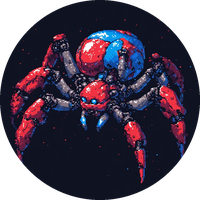
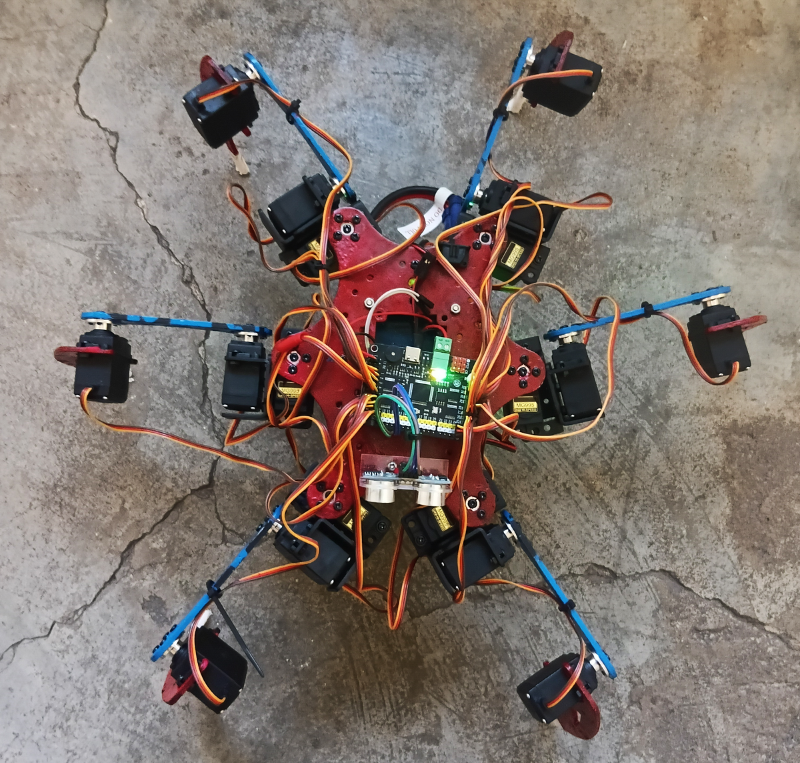
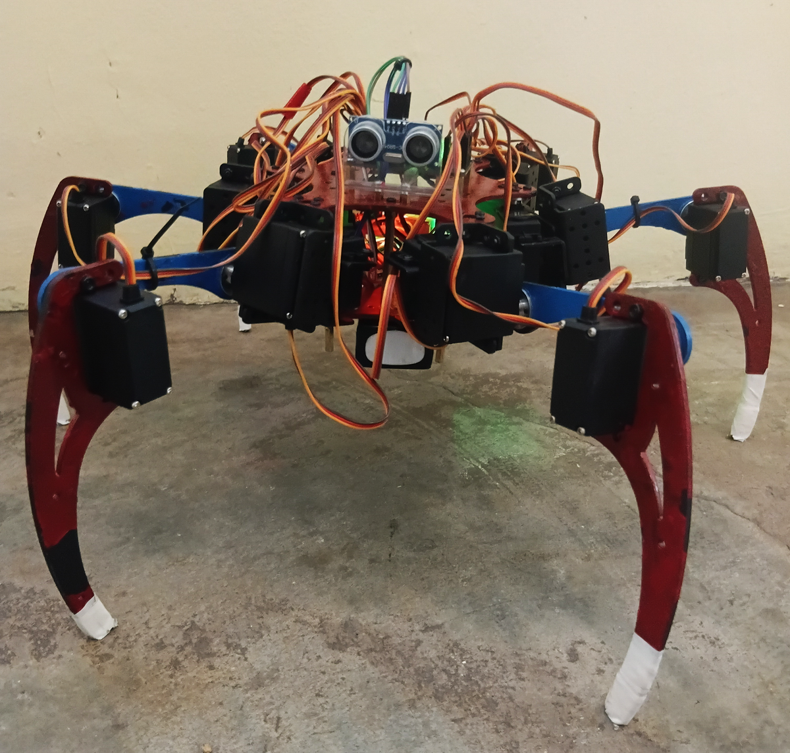
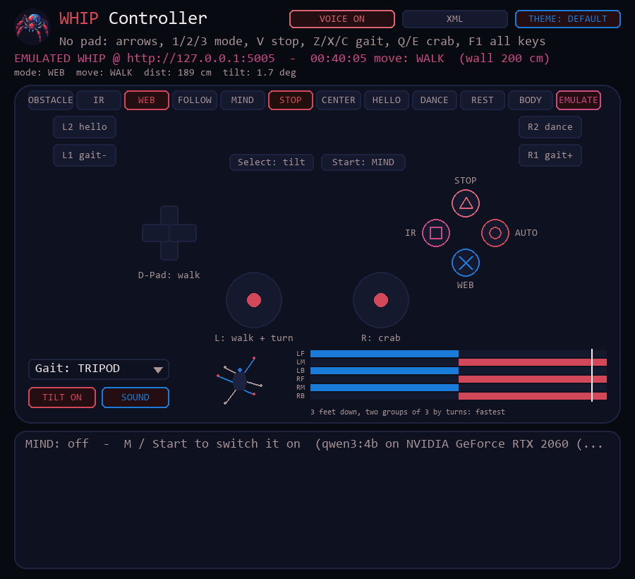

<p align="center"></p>

[](https://x.com/NorowaretaGemu)
[](https://opensource.org/licenses/MIT)
  
<br>
<div align="center">
  <a href="https://ko-fi.com/cursedentertainment">
    
  </a>
</div>
<div align="center">
  
</div>
<div align="center">
  
  
</div>
<div align="center">
  
</div>

# WHIP 
## Walking Hexapod Intelligence Platform

- Robot Type: Hexapod

<div align="center">
  
  <p><i>WHIP</i></p>
</div>

---

### Software
- [Arduino IDE](https://docs.arduino.cc/software/ide/)

---

## Related Projects

- [KIDA-Robot-v00](https://github.com/CursedPrograms/KIDA-Robot-v00)
- [KIDA-Robot-v01](https://github.com/CursedPrograms/KIDA-Robot-v01)
- [NORA-Robot-v00](https://github.com/CursedPrograms/NORA-Robot-v00)
- [DREAM](https://github.com/CursedPrograms/DREAM)
- [RIFT](https://github.com/CursedPrograms/RIFT)
- [RITA](https://github.com/CursedPrograms/RITA)

---

<div align="center">
  
</div>

---

## 📖 Overview

<details>
<summary><b>Overview</b></summary>

WHIP is an 18-servo hexapod. An ESP32 runs the behaviour, WiFi and a browser control page, and streams pre-tuned gait poses to an RTrobot 32-channel servo controller, which moves all the joints together. An MPU6050 watches for tipping and an HC-SR04 watches the way ahead.

### Core Features
- [x] 18-DOF walking: forward, backward, turn left and turn right gaits, plus stand, rest and shut-down poses.
- [x] Three control modes: Obstacle Avoidance (the boot default), IR Remote, and Web (the browser page or the Python controller).
- [x] Tilt safety: past 20° of pitch or roll for 500 ms he stops and stands, and resumes once he is back under 12°.
- [x] Obstacle avoidance: walks until something is closer than 35 cm, then stands, turns (left and right by turns) and walks on once the way is clear past 50 cm.
- [x] Fleet: joins NORA's network when it's in range and registers with the fleet, or hosts his own `WHIP` access point.
- [x] Starts walking in obstacle avoidance 5 s after power-on (WiFi joins in the background).
- [x] MIND mode: the LLM on his PC controller drives him, one short move at a time, and talks in his own voice (a theatrical show-off, David). M / Start on the Python controller, or MIND on his page while it's connected.
- [x] Wall stop when driven by hand: from the remote or the web he won't walk forward into something within 20 cm, and a step already under way stops (`/status` says `blocked`).
- [x] Gamepad rumble: the pad buzzes harder as he walks towards a wall (from 40 cm, full at 15 cm), and shakes when he tips past 10°.

</details>

---

## Prerequisites

<details>
<summary><b>Prerequisites</b></summary>

### Software
- [Arduino IDE](https://docs.arduino.cc/software/ide/) with the ESP32 board package
- Library: [`IRremote`](https://github.com/Arduino-IRremote/Arduino-IRremote) 4.x (`WiFi`, `WebServer`, `HTTPClient` and `Wire` come with the ESP32 core)
- Python 3 with `pygame` and `requests` for the desktop controller (`pip install -r requirements.txt`)

### Hardware

| **Component** | **Details** |
|-----------|---------|
| Microcontroller | ESP32 (the same module as NORA) |
| Servo controller | RTrobot 32-channel servo controller (UART, 115200 baud) |
| Chassis | 18-DOF hexapod chassis |
| Servos | 18 × MG995 180° |
| Battery | 3S LiPo |
| Regulator | UBEC set to 6 V |
| Distance | HC-SR04 ultrasonic sensor |
| Balance | MPU6050 gyro + accelerometer |
| Remote | NEC IR receiver + remote (the same remote as MILA and IDA) |
| Controllers | Browser, PS2-style USB gamepad (Python controller), IR remote |

Chassis Instruction Manual: https://1drv.ms/b/c/e7037d9b1b4cf216/EZ1ctC5zh_tOmuoInNRW6fgBGUFWBfHWW5chNCMn1rw6kQ?e=z3zNVd](https://1drv.ms/b/c/e7037d9b1b4cf216/EZ1ctC5zh_tOmuoInNRW6fgBGUFWBfHWW5chNCMn1rw6kQ?e=z3zNVd)

</details>

---

<div align="center">
  
</div>

---

# Schematics
## ⚡ Technical Pinouts

<details>
<summary><b>Power</b></summary>

```
3S LiPo ──────► UBEC (set to 6 V)
UBEC 6 V ─────► RTrobot servo controller V+ / GND   (servo power)
ESP32 ────────► USB or 5 V from the servo controller's logic rail
All grounds tied together
```

</details>

> [!TIP]
> Set the UBEC to 6 V **before** connecting the servos, and make sure every module shares a common ground.

<details>
<summary><b>ESP32 wiring</b></summary>

| Signal | ESP32 pin |
|---|---|
| Servo controller RX ← ESP32 TX | GPIO 1 (TX0) |
| Servo controller TX → ESP32 RX | GPIO 3 (RX0) |
| Debug console (optional USB-TTL) | GPIO 16 (RX2), GPIO 17 (TX2) |
| HC-SR04 TRIG / ECHO | GPIO 12 / GPIO 13 |
| MPU6050 SDA / SCL | GPIO 21 / GPIO 22 |
| IR receiver OUT | GPIO 14 |

The servo controller shares UART0 with the USB-serial bridge, exactly like NORA's ESP32↔Arduino link. **Disconnect the controller's wires before uploading**, then reconnect. Boot and status logging goes to Serial2 (GPIO 17) instead.

</details>

<details>
<summary><b>Servo channels</b></summary>

The gaits drive RTrobot channels **1–9** and **24–32** (18 servos, three per leg). Which channel is which leg and joint, and each servo's trim and direction, are set on `/calib` (defaults in `ik_gait.h`: channels 1-9 the left legs front to back, 24-32 the right).

`scripts/servo_setup/servo_setup.ino` sends every channel to 1500 µs (centre) for fitting the servo horns. It runs on an Arduino with the controller on SoftwareSerial pins 11 (RX) and 10 (TX) at 9600 baud.

</details>

---

## 🌐 Connectivity & Controls

<details>
<summary><b>Connectivity & Controls</b></summary>

### Network
On boot WHIP joins the highest fleet network he can see (the fleet's ladder: RIFT, DREAM, NINA, TINA, the controllers, NORA) and registers with the fleet. With none in range he hosts his own, and he looks again every minute. Joining happens in the background, so he walks off 5 s after power-on either way.

| Parameter | Value |
| :--- | :--- |
| **Fleet networks** | RIFT, DREAM, NINA, TINA, the controllers, NORA (the fleet's password, `scripts/esp32/secrets.h`) |
| **WHIP's own AP** | SSID `WHIP`, the fleet's password |
| **Control page** | `http://<WHIP's IP>:5005/` |
| **Fleet registry** | `192.168.4.1:5000/register` (heartbeat every 10 s) |

### RIFT Integration
WHIP's control page is on port `5005`, the port [RIFT](https://github.com/CursedPrograms/RIFT) assigns him. On the fleet's network he shows up in RIFT's Registered Fleet list.

### Control modes
| Mode | How | What it does |
|---|---|---|
| **Obstacle Avoidance** | IR `2`, web, gamepad Circle | Walks on his own and turns away from anything within 35 cm (starts 5 s after power-on) |
| **IR Remote** | IR `1`, gamepad Square | Arrows walk and turn while held. He stands when you let go (350 ms timeout) |
| **Web** | Web page, gamepad Cross | D-pad on the page or the Python controller. He stands if the browser goes quiet for 500 ms |
| **Mind** | `M` / Start on the Python controller, or MIND on his page | The LLM on his PC controller drives him: he stands while it thinks, then makes one short move, says what he thinks in his own voice, and remembers. Only a controller on an x86 PC with 8 GB+ RAM and a GTX 1050 or better (AMD RX 460 / 560 or better) offers it; the MIND button on his page only shows while one is connected. He stops at walls, and leaves MIND mode 5 s after that controller goes quiet |

### Driven by NORA (fleet IR link)
[NORA](https://github.com/CursedPrograms/NORA-Robot-v00) can drive WHIP through her IR transmitter, from her web page, Python controller or Bluetooth. The frames are Samsung-format IR at address `0x0DA3`, with the fleet link's commands: `0x48` forward, `0x49` back, `0x4A` left, `0x4B` right, `0x4C` stop, `0x4D` obstacle mode, `0x4E` manual, `0x4F` speed. Driving switches her into IR Remote mode, and each command runs as the matching remote button. She stands once the link has been quiet for 600 ms (frames can land mid-step). She has one gait speed, so `speed` is ignored. Link frames print as `LINK cmd=0x..`.

### Controls
Every key, gamepad button and remote button. The same list opens in its own window: **F1** in the Python controller, **KEYS** on his web page (`/keys`), or `python scripts/keymap.py`.

<!-- keymap:start -->
<!-- generated by keymap.py --readme; edit the list there -->

**Controller: keyboard**

| Key | Does |
|---|---|
| W / Up | walk forward (hold) |
| S / Down | walk back (hold) |
| A / Left, D / Right | turn left / right (hold) |
| Z | the controller drives (web mode) |
| X | obstacle avoidance: he walks by himself |
| C | IR-remote mode |
| V | stop |
| M | MIND mode on / off: the LLM on this PC drives him (x86 PC, GTX 1050+) |
| F1 | this window |
| Esc | quit |

**Controller: gamepad or joystick (ARM's flight stick works too)**

| Key | Does |
|---|---|
| Left stick / D-pad | walk forward / back, turn left / right |
| Cross / A (0) | the controller drives (web mode) |
| Circle / B (1) | obstacle avoidance |
| Square / X (2) | IR-remote mode |
| Triangle / Y (3) | stop |
| Start (11) | MIND mode on / off |
| | *plug it in any time* |

**His IR remote**

| Key | Does |
|---|---|
| 1 | IR-remote mode (he boots in obstacle avoidance: press this first) |
| 2 | obstacle avoidance |
| Up / Down | walk forward / back (hold) |
| Left / Right | turn left / right (hold) |
| OK | stop |
| | *NORA's remote sends other codes: it can't drive him* |

**NORA's IR link (her web page, controller or Bluetooth)**

| Key | Does |
|---|---|
| arrows / I J K L | walk / turn |
| STOP | stop |
| AUTO / MANUAL | obstacle avoidance / IR-remote mode |
| LOCK / UNLOCK | lock his legs (he stands, walks for nobody) / free them |
| | *the same lock over WiFi: /motorlockOn, /motorlockOff?pw=<his PIN> (RIFT's Lock all / Unlock all)* |

**Web page (:5005)**

| Key | Does |
|---|---|
| PIN, then the D-pad | unlock with the PIN, then walk (hold) |
| Mode buttons | obstacle / IR / web, and MIND while his PC controller can think |
| KEYS | this list |
| /calib | line the legs up (stand, trims, height, speed) |

**Debug console (Serial2, GPIO17, 115200)**

| Key | Does |
|---|---|
| x | shut down: settle into the lowest stance |

<!-- keymap:end -->

### Python controller (`scripts/controller.py`)
Draws a PS2-style pad and drives WHIP over WiFi. It finds him on NORA's network first, and on his own AP otherwise. It unlocks him with his PIN, and `M` / Start switches on his mind (`scripts/mind.py`).

| Input | Action |
|---|---|
| D-pad / arrow keys | Forward, backward, turn left, turn right |
| Cross (A) | Web control mode (needed before driving) |
| Circle (B) | Obstacle Avoidance mode |
| Square (X) | IR Remote mode |
| Triangle (Y) | Emergency stop (stand) |

</details>

---

<details>
<summary><b>Gaits</b></summary>

### Walking by inverse kinematics
WHIP walks only by working out every joint from where each foot should be, in millimetres (`scripts/esp32/ik_gait.h`), instead of playing recorded poses (the old `gait.xml` gaits are gone from the firmware). The leg maths, the chassis measurements and the tripod gait come from **Jakob Leander's hexapod** ([code](https://github.com/JakobLeander/hexapod), MIT licence; [video series](https://www.youtube.com/@jakobleander)). WHIP is built on the same chassis. WHIP's own parts are the RTrobot controller link, the channel map, and the calibration page. Everything online stays as it was: web control, fleet, IR, obstacle avoidance and tilt safety.

- **Calibrate once** at `http://<WHIP>:5005/calib`, with the PIN and the feet off the ground.
  - **ZERO** puts every servo in its middle. Each leg should then point straight out from the body, thigh level, foot hanging down.
  - Trim each servo until it does. **WIGGLE** checks a servo's channel, and **rev** flips a direction.
  - **SAVE** keeps it all in flash, so no reflash is needed.
- Height (0-9) and speed (0-9) are set on the same page.
- `GET /status` now also reports `gait`, `calibrated`, `height` and `speed`.

### Gait reference
The patterns below are design notes for future gaits. The firmware walks the tripod gait.

| Gait | Logic | Best for |
| :--- | :--- | :--- |
| **Tripod** | `{L1, R2, L3}` then `{R1, L2, R3}`: three legs move, three hold a triangle | Speed on flat ground |
| **Wave** | `L3 → L2 → L1 → R3 → R2 → R1`, one leg at a time | Maximum stability |
| **Ripple** | `{L3, R1} → {L2, R3} → {L1, R2}`, two legs at a time | Smooth, lifelike motion |
| **Amble** | Two non-opposite legs lifted together | Spreading load differently |
| **Metachronal** | A sequential "Mexican wave" | Tight corridors |
| **Rotational** | Legs circle the centre axis | Turning 360° in place |
| **Sidewinding** | Sideways without changing heading | Strafing round obstacles |
| **Stair / climb** | High tibia lift | Steps and debris |

> [!TIP]
> Lifting a leg (femur servo) must be coordinated with extending it (coxa servo) to keep the centre of gravity inside the support triangle, or WHIP will tip.

</details>

---

## How to Run:
<details>
<summary><b>View How to Run</b></summary>

1. Flash `scripts/esp32/esp32.ino` to the ESP32 (servo controller wires disconnected), then reconnect them. `flash.bat` does it all for the ESP32: on a fresh PC it installs the Arduino command line tool, the ESP32 board package (3.3.12) and the libraries by itself, then finds the port, compiles and flashes, talking you through it.
2. Power WHIP. He stands at 2 s, holds still while his gyro calibrates, and walks off in Obstacle Avoidance mode at 5 s. His WiFi (the fleet's network, or his own `WHIP` AP) joins in the background.
3. Open `http://<WHIP's IP>:5005/` in a browser, or run the Python controller:

```bash
python -m venv venv
source venv/bin/activate          # Windows: venv\Scripts\activate
pip install -r requirements.txt
python scripts/controller.py      # or ./scripts/launch_controller.sh
```
</details>

---

## 📡 Who's nearby (ESP-NOW + Bluetooth LE)

Every robot sends a small **"I'm here"** beacon twice a second and listens for the others'. From the **signal strength** it knows roughly how close each one is, and from how that changes over time whether it's **coming closer, steady or leaving**:

| Signal | Zone |
| :--- | :--- |
| above −45 dBm | very close |
| −45 to −60 dBm | near |
| −60 to −75 dBm | medium |
| below −75 dBm | far |

It's coarse (walls, bodies and antenna angle all change it): for "who's around", not distance. Precise collision avoidance stays with the ultrasonic and ToF sensors.

**They tell each other what they're doing**, because a rising signal looks the same from both sides even when only one robot moves. Over ESP-NOW they say it **in Brainfuck**, like the fleet's conversations: each beacon carries a program that prints `park`, `go`, `wait` or `hand` (a human is driving), and the receiver runs it. Bluetooth adverts are too small for a program, so BLE carries the same state as one byte.

**Who makes way**, in self-driving modes only:

| The other robot... | So this one... |
| :--- | :--- |
| is parked | is the one closing in: steers away |
| is yielding | carries on, carefully |
| is driven by a human | makes way (it's unpredictable) |
| drives itself | follows the alphabet: KIDA00, KIDA01, NORA, WHIP; everyone makes way for MILA, who can't hear the others |
| is leaving | carries on |

Making way = stop for 2 s, turn away, then drive on (and not yield again for 5 s, so two robots that stay close don't take turns forever). While another robot is near, or coming closer, it drives slower with wider margins.

WHIP hears the others over **ESP-NOW** (NORA, MILA) and **Bluetooth LE** (NORA, KIDA-00, KIDA-01). In **obstacle** mode he stands still and then turns away when a robot with right of way is close. `GET /near` shows his list. Code: `scripts/esp32/fleet_near.h` and `fleet_near_ble.h` (BLE adds a lot of code: he may need the *Huge APP* partition scheme).

---

## Screenshots

<div align="center">
  
</div>

<p align="center"><i>Python controller. Captured without a robot connected, so live values show their offline state.</i></p>

---

<br>
<div align="center">
© Cursed Entertainment 2026
</div>
<br>
<div align="center">
<a href="https://cursed-entertainment.itch.io/" target="_blank">
    
</a>
</div>
<br>
<div align="center">
  <a href="https://github.com/SynthWomb" target="_blank">
    
  </a>
</div>

---

<!-- DREAM-ECOSYSTEM:START -->
## The DREAM Robotics ecosystem

**Minds** — [DREAM](https://github.com/CursedPrograms/DREAM) companion · [TINA](https://github.com/CursedPrograms/TINA) engineer · [NINA](https://github.com/CursedPrograms/NINA) caretaker · [RIFT](https://github.com/CursedPrograms/RIFT) fleet hub · [LYCEA](https://github.com/CursedPrograms/LYCEA) training school  
**Robots** — [NORA](https://github.com/CursedPrograms/NORA-Robot-v00) · [MILA](https://github.com/CursedPrograms/MILA-Robot-v00) · [WHIP](https://github.com/CursedPrograms/WHIP-Robot-v00) · [KIDA-00](https://github.com/CursedPrograms/KIDA-Robot-v00) · [KIDA-01](https://github.com/CursedPrograms/KIDA-Robot-v01) · [IDA](https://github.com/CursedPrograms/IDA-Robot-v00) · [ARM](https://github.com/CursedPrograms/ARM-Robot-v01) · [NIKA](https://github.com/CursedPrograms/NIKA-Robot-v00)  
**Remotes** — [RITA](https://github.com/CursedPrograms/RITA) handheld remote  
<!-- DREAM-ECOSYSTEM:END -->
