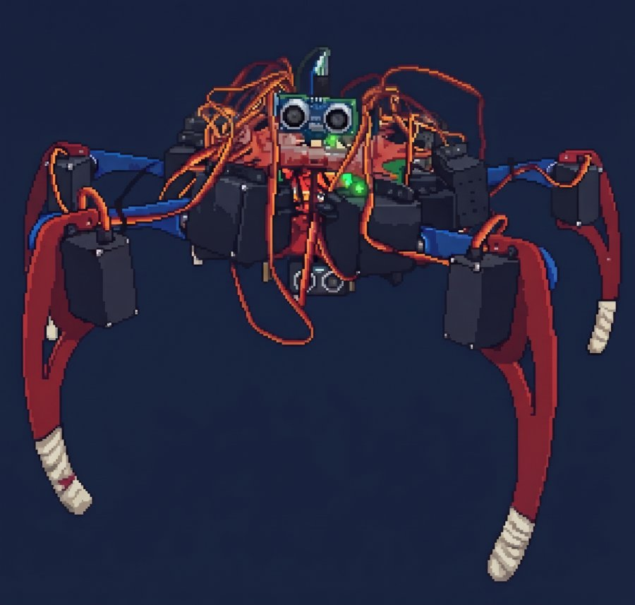
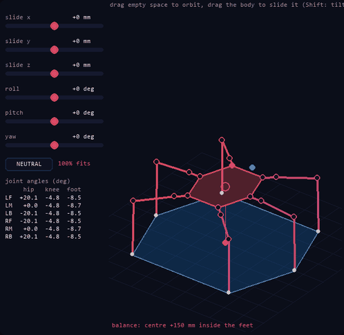
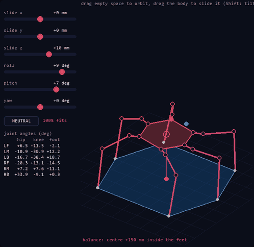
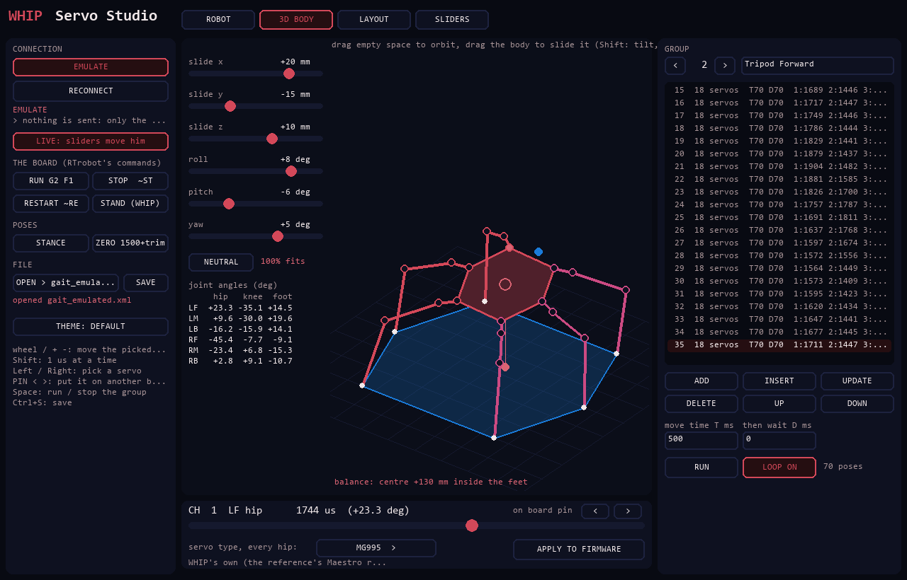
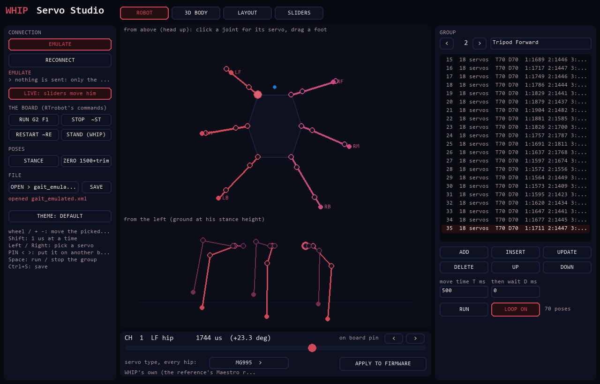
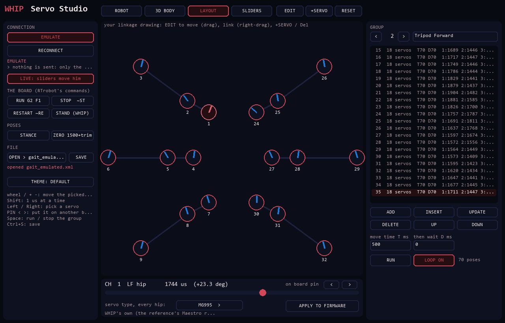
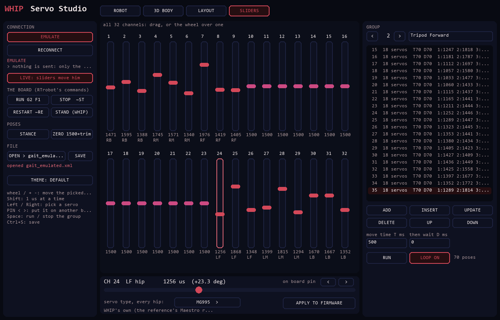
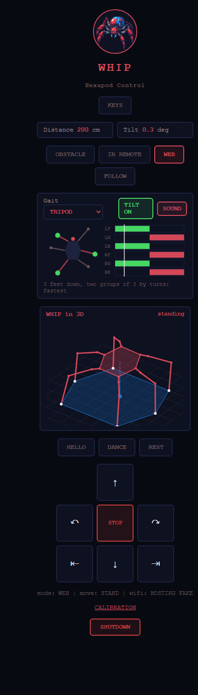

<p align="center"></p>

[](https://x.com/NorowaretaGemu)
[](https://opensource.org/licenses/MIT)
  
<br>
<div align="center">
  <a href="https://ko-fi.com/cursedentertainment">
    
  </a>
</div>
<div align="center">
  
</div>
<div align="center">
  
  
</div>
<div align="center">
  
</div>

# WHIP 
## Walking Hexapod Intelligence Platform

- Robot Type: Hexapod

<div align="center">
  
  
  <p><i>WHIP: his character, and the machine</i></p>
</div>

<div align="center">
  
  
  <p><i>Walking (his Tripod Forward macro in Servo Studio's 3D view) and body IK (his body over planted feet)</i></p>
</div>

---

### Software
- [Arduino IDE](https://docs.arduino.cc/software/ide/)

---

## Related Projects

- [KIDA-Robot-v00](https://github.com/CursedPrograms/KIDA-Robot-v00)
- [KIDA-Robot-v01](https://github.com/CursedPrograms/KIDA-Robot-v01)
- [NORA-Robot-v00](https://github.com/CursedPrograms/NORA-Robot-v00)
- [DREAM](https://github.com/CursedPrograms/DREAM)
- [RIFT](https://github.com/CursedPrograms/RIFT)
- [RITA](https://github.com/CursedPrograms/RITA)

---

<div align="center">
  
</div>

---

## 📖 Overview

<details>
<summary><b>Overview</b></summary>

WHIP is an 18-servo hexapod. An ESP32 runs the behaviour, WiFi and a browser control page, and works out every joint by inverse kinematics, sending the angles to an RTrobot 32-channel servo controller that moves all the joints together. An MPU6050 watches for tipping and an HC-SR04 watches the way ahead.

### Core Features
- [x] 18-DOF walking by inverse kinematics: six gaits (tripod, ripple, wave, quad, amble, metachronal), each checked to keep his centre inside his feet; forward, back, turning, crabbing sideways and analog stick driving, plus stand, rest and shut-down poses.
- [x] **Play WHIP** in your browser ([play.html](https://cursedprograms.github.io/WHIP-Robot-v00/play.html)): his own gait engine and IK ported to JavaScript, drawn in CSS 3D. Walk, turn and crab him round an arena collecting orbs, all six gaits, hello, dance and rest, with the keyboard, a touch pad or a gamepad; it shows the joint pulses his servos would get.
- [x] Body IK: his body slides (x / y / z) and tilts (roll / pitch / yaw) over planted feet, fitted so every foot reaches: `/body`, the controller's BODY mode, the PS2 pad's BODY mode (R3), Servo Studio's 3D BODY.
- [x] A PS2 pad on WHIP himself: its 9-pin receiver straight on four pins (`ps2.h`), the sticks steering his gaits.
- [x] WHIP in 3D on his own web page (plain JavaScript, live from `/pose`), and in Servo Studio.
- [x] His voice through the controller outside MIND too (David: theatrical, scared of his own feet).
- [x] Servo types in `servo_config.json` (MG995 / MG996R / SG90 / DS3218 or your own), written into the firmware by APPLY TO FIRMWARE.
- [x] Follow-me, wave hello, dance, lying down after a minute standing still, and a picked-up stop.
- [x] 4x4 RGB LED grid and a buzzer that show what he's doing.
- [x] Calibration page (`/calib`): channel, direction and trim for all 18 servos, kept in flash.
- [x] Three control modes: Obstacle Avoidance (the boot default), IR Remote, and Web (the browser page or the Python controller).
- [x] Tilt safety: past 20° of pitch or roll for 500 ms he stops and stands, and resumes once he is back under 12°.
- [x] Obstacle avoidance: walks until something is closer than 35 cm, then stands, turns (left and right by turns) and walks on once the way is clear past 50 cm.
- [x] Fleet: joins NORA's network when it's in range and registers with the fleet, or hosts his own `WHIP` access point.
- [x] Starts walking in obstacle avoidance 5 s after power-on (WiFi joins in the background).
- [x] MIND mode: the LLM on his PC controller drives him, one short move at a time, and talks in his own voice (a theatrical show-off, David). M / Start on the Python controller, or MIND on his page while it's connected.
- [x] Wall stop when driven by hand: from the remote or the web he won't walk forward into something within 20 cm, and a step already under way stops (`/status` says `blocked`).
- [x] Gamepad rumble: the pad buzzes harder as he walks towards a wall (from 40 cm, full at 15 cm), and shakes when he tips past 10°.

</details>

---

## Prerequisites

<details>
<summary><b>Prerequisites</b></summary>

### Software
- [Arduino IDE](https://docs.arduino.cc/software/ide/) with the ESP32 board package
- Library: [`IRremote`](https://github.com/Arduino-IRremote/Arduino-IRremote) 4.x (`WiFi`, `WebServer`, `HTTPClient` and `Wire` come with the ESP32 core)
- Python 3 with `pygame` and `requests` for the desktop controller (`pip install -r requirements.txt`)

### Hardware

| **Component** | **Details** |
|-----------|---------|
| Microcontroller | ESP32 (ACEBOTT QA007 ESP32 Max, the same board as NORA) |
| Servo controller | RTrobot 32-channel servo controller (UART, 115200 baud) |
| Chassis | 18-DOF hexapod chassis |
| Servos | 18 × MG995 180° |
| Battery | 3S LiPo |
| Regulator | UBEC set to 6 V |
| Distance | HC-SR04 ultrasonic sensor |
| Balance | MPU6050 gyro + accelerometer |
| Remote | NEC IR receiver + remote (the same remote as MILA and IDA) |
| Lights | 4x4 WS2812 RGB LED grid |
| Sound | Passive buzzer |
| Handheld pad | PS2 pad + its 9-pin receiver (the Arduino kind), read by `ps2.h` |
| Controllers | Browser, PS2-style USB gamepad (Python controller), IR remote |

</details>

<details>
<summary><b>📂 Documentation & Assets</b></summary>

* [ACEBOTT ESP32 Max V1.0 Docs](https://acebottteam.github.io/acebott-docs-master/board/ESP32/QA007%20ESP32%20Max%20V1.0%20Controller%20Board.html)
* [ACEBOTT: Getting started with ESP32](https://acebott.com/docs/getting-started-with-esp32/)
* [CH340 Driver Download](https://acebottteam.github.io/acebott-docs-master/getting%20started/Arduino/Download%20CH340%20Driver%20on%20Windows%20System.html)
* [RTrobot software](https://rtrobot.org/doku.php?id=software) (his servo controller's: the editor `gait.xml` and `gait_emulated.xml` open in)
* [Chassis Instruction Manual](https://1drv.ms/b/c/e7037d9b1b4cf216/EZ1ctC5zh_tOmuoInNRW6fgBGUFWBfHWW5chNCMn1rw6kQ?e=z3zNVd)

</details>

---

<div align="center">
  
</div>

---

# Schematics
## ⚡ Technical Pinouts

<details>
<summary><b>Power</b></summary>

```
3S LiPo ──────► UBEC (set to 6 V)
UBEC 6 V ─────► RTrobot servo controller V+ / GND   (servo power)
ESP32 ────────► USB or 5 V from the servo controller's logic rail
All grounds tied together
```

</details>

> [!TIP]
> Set the UBEC to 6 V **before** connecting the servos, and make sure every module shares a common ground.

<details>
<summary><b>ESP32 wiring</b></summary>

| Signal | ESP32 pin |
|---|---|
| Servo controller RX ← ESP32 TX | GPIO 1 (TX0) |
| Servo controller TX → ESP32 RX | GPIO 3 (RX0) |
| Debug console (optional USB-TTL) | GPIO 16 (RX2), GPIO 17 (TX2) |
| HC-SR04 TRIG / ECHO | GPIO 12 / GPIO 13 |
| MPU6050 SDA / SCL | GPIO 21 / GPIO 22 |
| IR receiver OUT | GPIO 14 |
| RGB LED grid DIN (~330 Ω in line) | GPIO 18 |
| Buzzer | GPIO 19 |
| PS2 pad receiver DAT / CMD / ATT / CLK | GPIO 27 / 25 / 26 / 32, VCC from **3.3 V** (H16's middle pin) |
| Build switch (on: every servo at 1500 us) | GPIO 33 → switch → GND |

**Build switch:** a toggle switch from GPIO 33 to GND (the ESP32's own pull-up, no resistor). On, every servo goes to its plain middle, 1500 us with no trim and no direction, so each horn goes on straight while he's built; he holds it and nothing drives him. On at power-up, he goes straight to the middle without standing first. Off, he stands up in WEB mode and waits (he doesn't walk off by himself). `/status` says `centred`. CENTER on the controller and ZERO on `/calib` are different: those add each servo's trim.

The servo controller shares UART0 with the USB-serial bridge, exactly like NORA's ESP32↔Arduino link. **Disconnect the controller's wires before uploading**, then reconnect. Boot and status logging goes to Serial2 (GPIO 17) instead.

</details>

<details>
<summary><b>Servo channels</b></summary>

The gaits drive RTrobot channels **1–9** and **24–32** (18 servos, three per leg). Which channel is which leg and joint, and each servo's trim and direction, are set on `/calib` (defaults in `ik_gait.h`, as he is wired, each leg on the pins nearest it: 1-9 the right legs back to front, 24-32 the left legs front to back).

How WHIP is wired: each leg on the servo board's pins nearest it (left and right as he sees it, the sonar at the front).

The board counts its pins right to left, so channel 1 is its furthest right. Each leg is on the pins nearest it, which makes the channels run round the body in a U: from 1 at the back right, up the right side to the front, across the gap (10-23 unused) to 24 at the front left, and down the left side to 32 at the back left. It starts at the back and ends at the back: the shortest wire for every leg, none crossing over.

```
        front (sonar)
  24-26 ┌─────┐ 7-9
  27-29 │     │ 4-6
  30-32 └─────┘ 1-3
        back
```

Don't assume both sides run front to back (the old default did, and he turned the wrong way). Every hip servo also turns clockwise (seen from above) for a bigger pulse, the other way to the IK, so all six hips are reversed (`rev`). The old default had both wrong, and the two mistakes cancelled out for walking forward but not for turning. The map lives in `DEFAULT_CAL` in `scripts/esp32_gaits/ik_gait.h`, `scripts/whip_body.py`, `scripts/fake_whip.py` and `whip_calibration.json`: keep them the same.

| Channels (hip, knee, foot) | Leg | Old default (wrong, before Oct 2026) |
|---|---|---|
| 1-3 | right back | left front |
| 4-6 | right middle | left middle |
| 7-9 | right front | left back |
| 24-26 | left front | right front |
| 27-29 | left middle | right middle |
| 30-32 | left back | right back |

The old default made him turn the wrong way and wave a back leg. A calibration saved under it moves over by itself (each channel keeps its trim and direction).

`scripts/servo_setup/servo_setup.ino` sends every channel to 1500 µs (centre) for fitting the servo horns. It runs on an Arduino with the controller on SoftwareSerial pins 11 (RX) and 10 (TX) at 9600 baud.

</details>

---

## 🌐 Connectivity & Controls

<details>
<summary><b>Connectivity & Controls</b></summary>

### Network
On boot WHIP joins the highest fleet network he can see (the fleet's ladder: RIFT, DREAM, NINA, TINA, the controllers, NORA) and registers with the fleet. With none in range he hosts his own, and he looks again every minute. Joining happens in the background, so he walks off 5 s after power-on either way.

| Parameter | Value |
| :--- | :--- |
| **Fleet networks** | RIFT, DREAM, NINA, TINA, the controllers, NORA (the fleet's password, `scripts/esp32/secrets.h`) |
| **WHIP's own AP** | SSID `WHIP`, the fleet's password |
| **Control page** | `http://<WHIP's IP>:5005/` |
| **Fleet registry** | `192.168.4.1:5000/register` (heartbeat every 10 s) |

### RIFT Integration
WHIP's control page is on port `5005`, the port [RIFT](https://github.com/CursedPrograms/RIFT) assigns him. On the fleet's network he shows up in RIFT's Registered Fleet list.

### Control modes
| Mode | How | What it does |
|---|---|---|
| **Obstacle Avoidance** | IR `2`, web, gamepad Circle | Walks on his own and turns away from anything within 35 cm (starts 5 s after power-on) |
| **IR Remote** | IR `1`, gamepad Square | Arrows walk and turn while held. He stands when you let go (350 ms timeout) |
| **Web** | Web page, gamepad Cross | D-pad on the page or the Python controller. He stands if the browser goes quiet for 500 ms |
| **Mind** | `M` / Start on the Python controller, or MIND on his page | The LLM on his PC controller drives him: he stands while it thinks, then makes one short move, says what he thinks in his own voice, and remembers. Only a controller on an x86 PC with 8 GB+ RAM and a GTX 1050 or better (AMD RX 460 / 560 or better) offers it; the MIND button on his page only shows while one is connected. He stops at walls, and leaves MIND mode 5 s after that controller goes quiet |

### Driven by NORA (fleet IR link)
[NORA](https://github.com/CursedPrograms/NORA-Robot-v00) can drive WHIP through her IR transmitter, from her web page, Python controller or Bluetooth. The frames are Samsung-format IR at address `0x0DA3`, with the fleet link's commands: `0x48` forward, `0x49` back, `0x4A` left, `0x4B` right, `0x4C` stop, `0x4D` obstacle mode, `0x4E` manual, `0x4F` speed. Driving switches her into IR Remote mode, and each command runs as the matching remote button. She stands once the link has been quiet for 600 ms (frames can land mid-step). She has one gait speed, so `speed` is ignored. Link frames print as `LINK cmd=0x..`.

### Controls
Every key, gamepad button and remote button. The same list opens in its own window: **F1** in the Python controller, **KEYS** on his web page (`/keys`), or `python scripts/keymap.py`.

<!-- keymap:start -->
<!-- generated by keymap.py --readme; edit the list there -->

**Controller: keyboard**

| Key | Does |
|---|---|
| W / Up | walk forward (hold) |
| S / Down | walk back (hold) |
| A / Left, D / Right | turn left / right (hold) |
| 1 | the controller drives (web mode) |
| 2 | obstacle avoidance: he walks by himself |
| 3 | IR-remote mode |
| V | stop: he stands, in any mode (switches to web mode) |
| M | MIND mode on / off: the LLM on this PC drives him (x86 PC, GTX 1050+) |
| G | next gait: tripod, ripple, wave, quad, amble, metachronal (gaits firmware; or the Gait dropdown) |
| Z / X / C | tripod / ripple / wave |
| T | tilt safety on / off (on again at every boot) |
| B | buzzer on / off |
| Q / E | crab left / right (hold; gaits firmware) |
| F | follow-me mode: he keeps your hand 30 cm from his sonar |
| H / N | wave hello / a little dance |
| R | lie down / get up (he lies down by himself after a minute standing still) |
| Mouse | every function is a button: the strip along the top (modes, STOP, CENTER, HELLO, DANCE, REST, EMULATE), the pad's buttons, and the D-pad (hold) |
| CENTER | stop, every servo to its middle (1500 us + its trim); again: stand up |
| BODY | body IK: his body slides and tilts over planted feet. Sticks; or W/S A/D slide, R/F up / down, Q/E twist, I/K pitch, J/L roll |
| EMULATE | a pretend WHIP on this PC, to try the controller with no robot (scripts/fake_whip.py) |
| F1 | this window |
| Esc | quit |

**Controller: gamepad or joystick (ARM's flight stick works too)**

| Key | Does |
|---|---|
| Left stick / D-pad | walk forward / back, turn left / right (the stick with speed, gaits firmware) |
| Right stick | crab left / right (gamepads; gaits firmware) |
| Cross / A (0) | the controller drives (web mode) |
| Circle / B (1) | obstacle avoidance |
| Square / X (2) | IR-remote mode |
| Triangle / Y (3) | stop |
| Start (11) | MIND mode on / off |
| L1 / R1 (4 / 5) | previous / next gait |
| Select (8) | tilt safety on / off |
| L2 / R2 (6 / 7) | wave hello / dance |
| | *plug it in any time* |

**PS2 pad on WHIP himself (its receiver on GPIO 25 / 26 / 27 / 32, 3.3 V; gaits firmware)**

| Key | Does |
|---|---|
| Left stick / D-pad | walk and turn, with speed (takes over: WEB mode; let go and he stands) |
| Right stick | crab left / right |
| Cross / Triangle | stand (web mode) |
| Circle | obstacle avoidance |
| Square | follow-me mode |
| L1 / R1 | previous / next gait |
| L2 / R2 | wave hello / dance |
| Start | lie down / get up |
| Select | tilt safety on / off |
| L3 | buzzer on / off |
| R3 (right stick click) | BODY mode on / off: left stick slides his body, right stick tilts it, L1 / R1 twist, D-pad up / down raise / lower; feet stay planted |

**His IR remote**

| Key | Does |
|---|---|
| 1 | IR-remote mode (he boots in obstacle avoidance: press this first) |
| 2 | obstacle avoidance |
| Up / Down | walk forward / back (hold) |
| Left / Right | turn left / right (hold) |
| OK | stop |
| 3 / 4 / 5 | next gait / wave hello / dance (gaits firmware) |
| 6 / 7 | follow-me mode / lie down, get up |
| | *NORA's remote sends other codes: it can't drive him* |

**NORA's IR link (her web page, controller or Bluetooth)**

| Key | Does |
|---|---|
| arrows / I J K L | walk / turn |
| STOP | stop |
| AUTO / MANUAL | obstacle avoidance / IR-remote mode |
| LOCK / UNLOCK | lock his legs (he stands, walks for nobody) / free them |
| | *the same lock over WiFi: /motorlockOn, /motorlockOff?pw=<his PIN> (RIFT's Lock all / Unlock all)* |

**Web page (:5005)**

| Key | Does |
|---|---|
| PIN, then the D-pad | unlock with the PIN, then walk (hold) |
| Mode buttons | obstacle / IR / web, and MIND while his PC controller can think |
| Gait dropdown, G, 1-6 | tripod / ripple / wave / quad / amble / metachronal, with a little animation of the one picked |
| TILT, T | tilt safety on / off |
| SOUND, B | buzzer on / off |
| FOLLOW, F | follow-me mode |
| HELLO / DANCE / REST, H / N / R | wave hello, dance, lie down / get up |
| Crab buttons | the D-pad's bottom corners: sideways left / right |
| KEYS | this list |
| /calib | line the legs up (stand, trims, height, speed) |

**Debug console (Serial2, GPIO17, 115200)**

| Key | Does |
|---|---|
| x | shut down: settle into the lowest stance |

<!-- keymap:end -->

### Python controller (`scripts/controller.py`)
Draws a PS2-style pad and drives WHIP over WiFi (`run.bat` / `run.ps1` / `run.sh`). It finds him on the fleet's network first, and on his own AP otherwise. It unlocks him with his PIN, and `M` / Start switches on his mind (`scripts/mind.py`).

- **Every function is a button**: the strip along the top (OBSTACLE, IR, WEB, FOLLOW, MIND, STOP, CENTER, HELLO, DANCE, REST, EMULATE), the pad's own buttons, and the D-pad (hold the mouse on it to walk).
- **Driving takes over**: touch the D-pad, a stick or an arrow key while he walks by himself (OBSTACLE, FOLLOW) or listens to the remote, and he switches to WEB, does what's pressed and stands when you let go.
- **STOP** stands him in any mode. **CENTER** stops him and puts every servo at its middle (1500 us + its trim, `/calib`'s ZERO); again to stand up.
- **Settings stick**: mode, gait, tilt and sound are sent again until his status says so (mid-step he can miss a request).
- **Gamepads and joysticks**: a pad SDL knows (Xbox, PlayStation, Switch, most USB pads) goes through SDL's controller layer, so every one has the same buttons; anything else (ARM's flight stick, a pad SDL doesn't know) is read by the PS2-style pad's button numbers.
- **EMULATE**: a pretend WHIP on this PC (`scripts/fake_whip.py`), to try every button with no robot. He walks in a pretend room, his sonar reading drops as he nears a wall, and the status line shows what he just did. `python scripts/fake_whip.py` runs one on its own.
- **THEME**: DEFAULT, LIGHT or CUSTOM, all from `colour_scheme.xml` (sampled from his avatar). CUSTOM puts the scheme's colours in `scripts/controller_settings.json` for you to change.
- **XML**: his movements as RTrobot macros (below).
- **VOICE**: he talks through this PC's speakers outside MIND too (David's voice, as theatrical as ever):
  connecting, mode and gait changes, walls, tipping, being picked up and put down, lying down, CENTER,
  HELLO / DANCE, a PS2 pad plugged into him. VOICE turns it off; his last line shows in the bottom panel.
- The gait animation only plays while he walks.

<div align="center">
  
</div>

### His movements as RTrobot XML (`scripts/serial_to_xml.py`)
His ESP32 drives the servo controller with text lines (`#1P1500#2P1500...T70`) on the serial port that's also wired to its USB plug, so whatever he does can be written down as macros for the RTrobot editor, one pose per line, in the editor's own format. `gait.xml`, the hand-recorded original, is never touched.

| | How | Writes |
|---|---|---|
| **Emulated** | XML on the controller with EMULATE on, or `python scripts/serial_to_xml.py --emulate` | `gait_emulated.xml`: his own IK and gait code (`gaits.h`, built on the PC by `scripts/gait_test/serial_emu.cpp`) plays Stand, Zero and every gait forward, backward, turning and crabbing, from standing to standing, with the exact lines, timing and clamping his ESP32 sends |
| **Real** | XML on the controller while driving the real WHIP with his ESP32 on this PC's USB (XML again to stop), or `python scripts/serial_to_xml.py --port auto` | `gait_real.xml`: what he really sent, one macro per movement, named after what you drove (`Ripple Forward`, `Tripod Turn Left`) |

### WHIP Servo Studio (`servo_studio.bat` / `.ps1` / `.sh`)
What RTrobot's ServoController program does, as our own, plus WHIP on screen:

- **ROBOT**: WHIP from above and from the side, drawn from the servo pulses with his IK run backwards
  (`scripts/whip_body.py`, exact to the micrometre against `ik_gait.h`). Click a joint for its servo, wheel or
  drag to move it, or drag a foot and his IK sets all three of that leg's servos.
- **LAYOUT**: your own linkage drawing: servo dials anywhere, linked, each horn turning with its servo. It
  starts laid out like WHIP; EDIT moves (drag), links (right-drag), adds (+SERVO) and removes (Del) them,
  kept in `scripts/servo_layout.json`, so it works for any robot on the board.
- **SLIDERS**: all 32 channels, to play with.
- **Servo type**: which servo each joint is (MG995 on WHIP; MG996R, SG90, DS3218 180 / 270 to pick, or add your
  own) lives in `servo_config.json`: pulses per degree, the middle, the limits, how far it turns, per joint
  and per leg. **APPLY TO FIRMWARE** writes `scripts/esp32_gaits/servo_config.h` from it (`scripts/servo_config.py`)
  and flashes WHIP in its own window; `flash_gaits` writes it too, so hand edits to the JSON reach him as
  well. His IK (`toUs`), the emulator and the studio's drawing all use the same numbers.
- **PIN < >**: put the picked servo on another board pin. A servo already there swaps with it, the poses in
  every group follow, and the map is kept in `whip_calibration.json` (and on WHIP over WHIP WIFI).
- **Groups**: 255, each a list of poses: ADD the servos as a pose, INSERT / UPDATE / DELETE / UP / DOWN, RUN,
  LOOP; open and save RTrobot XML (`gait.xml` itself is saved as `gait_studio.xml`).
- **Connect**: EMULATE (just the drawing), SERIAL (the servo board's own USB, 115200; or a USB-TTL on its
  UART at the baud set on the board, 4800-115200, 9600 out of the box) or WHIP WIFI (through his `/servo`
  route).
- **The studio outranks everything**: it's the testing software. Connected to WHIP (WHIP WIFI, or SERIAL
  while his WiFi answers), it holds him (`/studio`). His controller, his web page, the IR remote, the PS2
  pad, MIND and tilt safety all wait, even on the same PC, because the studio is known by its session id,
  not its IP. They say "SERVO STUDIO HAS HIM". STAND (or closing the studio) gives him back, and he stands
  in WEB mode. If the studio just goes quiet, he's his own again after 5 s. A second studio is refused.
- **CALIBRATION**: the picked servo's TRIM - / + (5 us, Shift: 1 us; the joint moves with it), REV, WIGGLE,
  SAVE ON WHIP, DEFAULTS: the same calibration as his `/calib` page, kept in `whip_calibration.json` and on
  him. **REBOOT WHIP** restarts his ESP32.
- **One setting, everywhere**: every unlocked device can drive him at once (up to four: the PC controller,
  his page on a phone...). His `/status` carries `rev`, a fingerprint of every saved setting (lights, gait,
  height, speed, tilt safety, sound, body, calibration), so a change made anywhere shows everywhere: his
  pages (control, `/lights`, `/calib`), the controller and the studio fetch what they show again when it
  moves.
- **The board's commands** (from RTrobot's manual): `G<n>F<times>` runs a group stored on the board, `~ST`
  stops it, `~RE` restarts the board; its replies ("OK") show under the connection.
- **Not yet**: the board's own settings (its UART baud, start positions, deviation -99..99, buzzer, auto
  run) and Download / Read / Erase of its stored groups. RTrobot doesn't publish those commands; the clean
  way to learn them is to listen to what RTrobot's program sends when you click them, then the studio can
  send the same: `python scripts/rtrobot_sniff.py COM5` relays their program's TCP connection (ServoController:
  TCP, 127.0.0.1, port 8080) to the board's USB port and writes both directions to `rtrobot_sniff.log`. Don't
  set the board's password: their program says that erases its flash.

### His IK calibration (`scripts/ik_values.py`)
```bash
python scripts/ik_values.py show        # his live calibration + the IK constants in ik_gait.h
python scripts/ik_values.py get         # save it to whip_calibration.json (edit it by hand if you like)
python scripts/ik_values.py set         # send whip_calibration.json to him and save it in his flash
```
`serial_to_xml.py --emulate` uses `whip_calibration.json` when it's there, so the emulated XML has his real pulses.

### MIND log
Every step of his mind goes into `~/.robot_minds/logs/WHIP-<date>.log`: what he sensed, his whole thinking, what he said, the move and how it went.

</details>

---

<details>
<summary><b>Gaits</b></summary>

### Walking by inverse kinematics
WHIP walks only by working out every joint from where each foot should be, in millimetres (`scripts/esp32/ik_gait.h`), instead of playing recorded poses (the old `gait.xml` gaits are gone from the firmware). The leg maths, the chassis measurements and the tripod gait come from **Jakob Leander's hexapod** ([code](https://github.com/JakobLeander/hexapod), MIT licence; [video series](https://www.youtube.com/@jakobleander)). WHIP is built on the same chassis. WHIP's own parts are the RTrobot controller link, the channel map, and the calibration page. Everything online stays as it was: web control, fleet, IR, obstacle avoidance and tilt safety.

- **Calibrate once** at `http://<WHIP>:5005/calib`, with the PIN and the feet off the ground.
  - **ZERO** puts every servo in its middle. Each leg should then point straight out from the body, thigh level, foot hanging down.
  - Trim each servo until it does. **WIGGLE** checks a servo's channel, and **rev** flips a direction.
  - **SAVE** keeps it all in flash, so no reflash is needed.
- Height (0-9) and speed (0-9) are set on the same page.
- `GET /status` now also reports `gait`, `calibrated`, `height` and `speed`.

### Gaits sketch: `scripts/esp32_gaits`
The firmware WHIP runs now (flashed 2026-10-24, and he walks better than on the old one). It moves into `scripts/esp32` once it's been checked on the robot. Flash it with `flash_gaits.bat`.

- **Six gaits** from one engine (`gaits.h`): **tripod** (3 feet down, fastest), **ripple** (4 down, the most insect-like), **wave** (5 down, one leg at a time, easiest on the servos), **quad**, the tetrapod (4 down, three pairs taking turns back to front: LB + RM, LM + RF, LF + RB), **amble** (4 down, diagonal pairs with none straight across: LM + RB, LB + RF, LF + RM) and **metachronal** (5 down, one leg at a time round the body: LB, LM, LF, RF, RM, RB). Every one keeps his centre at least 40 mm inside the feet that are down while he walks (43-79 mm; `gait_test` checks it): lifting two legs straight across, or two neighbours one after the other, would put it on the edge. Every gait also crabs sideways (sidewinding) and turns on the spot (rotational). Every leg runs the same cycle from its own starting point; feet on the ground slide back together, and a swinging foot leaves and lands at the ground's speed, so nothing jerks. He speeds up over a cycle, and stops by stepping his feet home. Changing gait mid-walk: he steps to a stop and carries on in the new one. Checked on a PC: all six, heights 0-9, walking, turning, sideways and stopping, every foot in reach, no foot slipping, never fewer than 3 down.
- **Pick the gait** from the dropdown on his web page or the controller (each shows a little animation of it: WHIP from above and the step chart), or with G / Z X C (1-6 on his web page), or L1 / R1 on a gamepad. Saved in flash. IR 3 steps through them.
- **He talks the fleet's Brainfuck out loud**: `/chirp?u=<n>` (RIFT's conversations) beeps a phrase in his own lower voice, each symbol lighting his grid as it goes, and he can walk while he does. `talk_bf.h`, generated by RIFT.
- **Android app (`Android App/`, package `com.synthwomb`): FIND gets his address from the fleet list, or type it in. Hold the stick to drive, let go to stop, and his modes, HELLO, DANCE and REST are buttons. Build it with `gradlew assembleDebug`.**
- **LEVEL**: standing on a slope he tilts his body against it, a little at a time, feet planted (the LEVEL button; off at every boot). Its directions are worked out from the maths, not tried on him yet: if the reading gets worse he gives up and goes neutral.
- **Tip check**: `scripts/gait_test` also says how far his centre of mass can move, back and sideways, before each gait would tip him.
- **`whip.local`**: his address on the network, on port 5005.
- **Crab offset**: his back legs are mounted further back than the front ones, or he falls on his back end when he walks (the front hip servos can't go that far round). While he crabs his back feet land this many degrees in on their hips, 0-15, 5 to start with: the slider on his web page and the PC controller, CRAB - / + on RITA. Saved in flash.
- **Tilt safety on / off**: the TILT button, T, or Select. On again at every boot.
- **4x4 RGB LED grid** (WS2812, Adafruit NeoPixel) on GPIO18 (`leds.h`): WHIP from above, head at the top. The outer columns are his legs and light up while that foot is in the air; the middle shows his mode, the top row goes red at a wall, the bottom row orange while tilt safety is off, and the whole grid flashes orange on a tilt stop.
- **Buzzer** (passive) on GPIO19 (`buzzer.h`): chirps at boot, walls, tilt stops, gait and mode changes, and shutdown. SOUND button or B mutes it.
- **Avoiding walls he looks around**: a turn left, then right past the middle, noting how far his sonar sees each way, then he turns the clearer way, looking ahead as he turns.
- **Analog driving**: the controller's sticks walk him with speed, in curves; the right stick (or Q / E, or the D-pad's corner buttons) crabs sideways.
- **Follow me** (FOLLOW mode, F, IR 6): he keeps your hand 30 cm from his sonar, walking after it or backing off.
- **Body moves**: HELLO (H, L2, IR 4) shifts his weight back and waves the front left leg; DANCE (N, R2, IR 5) circles his body over his feet; locked by NORA he crouches.
- **Rest**: after a minute standing still (IR, web, MIND, follow) he lies down: belly to the floor on all six legs, legs spread out where they stand (no folding them up under him). Any move lifts him back into the stand. REST (R, IR 7) does it by hand; shutdown ends the same way.
- **Picked up**: a hard lift or drop on the MPU, or upside down, and his legs stop where they are (violet grid, a chirp) until he's been put down level for 2 s; then he stands up.
- **A PS2 pad on WHIP himself** (`ps2.h`, no library): its 9-pin receiver on GPIO 27 (DAT), 25 (CMD), 26 (ATT) and 32 (CLK), powered from **3.3 V** (H16's middle pin on his ACEBOTT board; the H1-H12 middle pins are 5 V, and a receiver on 5 V answers in 5 V, which the ESP32 can't take). It's not I2C: four plain pins, an SPI-like protocol. The sticks take over (WEB mode) and steer him live, mid-step: left stick walks and turns, right stick crabs, let go and he stands. Buttons: Cross / Triangle stand, Circle obstacle, Square follow, L1 / R1 gait, L2 / R2 hello / dance, Start lie down, Select tilt safety, L3 buzzer. `/status` says `ps2` while a pad answers. Compiles, not tried on a pad yet.
- IR 3-7 run on from 1 = 0x0 on the fleet's remote (the same as MILA, NIKA and IDA use; not NORA's).

### Gait reference
`scripts/esp32` walks the tripod gait; `scripts/esp32_gaits` has tripod, ripple, wave, quad, amble and metachronal, and every one of them turns on the spot and crabs. Stair / climb isn't in yet.

| Gait | Logic | Best for |
| :--- | :--- | :--- |
| **Tripod** | `{L1, R2, L3}` then `{R1, L2, R3}`: three legs move, three hold a triangle | Speed on flat ground |
| **Quad (tetrapod)** | `{L3, R2} → {L2, R1} → {L1, R3}`: two legs swing while four stay anchored (2/3 duty factor) | Between tripod and ripple: transitions between speeds |
| **Wave** | `L3 → L2 → L1 → R3 → R2 → R1`, one leg at a time | Maximum stability |
| **Ripple** | `{L3, R1} → {L2, R3} → {L1, R2}`, two legs at a time | Smooth, lifelike motion |
| **Amble** | `{LM, RB} → {LB, RF} → {LF, RM}`: two non-opposite legs lifted together | Spreading load differently |
| **Metachronal** | `LB → LM → LF → RF → RM → RB`: a "Mexican wave" round the body | Tight corridors |
| **Rotational** | Legs circle the centre axis: every gait does it when turning on the spot | Turning 360° in place |
| **Sidewinding** | Sideways without changing heading: every gait does it when crabbing | Strafing round obstacles |
| **Stair / climb** | High tibia lift | Steps and debris |

> [!TIP]
> Lifting a leg (femur servo) must be coordinated with extending it (coxa servo) to keep the centre of gravity inside the support triangle, or WHIP will tip.

</details>

---

## 🔧 Build status

The gaits firmware is flashed and he walks. What's left:

- [ ] Blue Loctite on the servo screws (metal threads only: threadlocker can crack plastic)
- [ ] Bearing under the body, to take the load off the servo horns
- [ ] Fit the RGB LED grid (GPIO 18) and the buzzer (GPIO 19), and check the grid isn't rotated or mirrored
- [ ] Calibrate the servo offsets on `/calib`, after the mechanical work
- [ ] Check on the robot: turns not swapped, IR 3-7, rest height, picked-up stop while walking, HELLO balance, showing up in RIFT

---

## How to Run:
<details>
<summary><b>View How to Run</b></summary>

1. Flash `scripts/esp32_gaits` with `flash_gaits.bat` / `.ps1` / `.sh` (the firmware WHIP runs now), or `scripts/esp32/esp32.ino` with `flash.bat`, to the ESP32 (servo controller wires disconnected), then reconnect them. `flash.bat` does it all for the ESP32: on a fresh PC it installs the Arduino command line tool, the ESP32 board package (3.3.12) and the libraries by itself, then finds the port, compiles and flashes, talking you through it.
2. Power WHIP. He stands at 2 s, holds still while his gyro calibrates, and walks off in Obstacle Avoidance mode at 5 s. His WiFi (the fleet's network, or his own `WHIP` AP) joins in the background.
3. Open `http://<WHIP's IP>:5005/` in a browser, or run the Python controller:

```bash
python -m venv venv
source venv/bin/activate          # Windows: venv\Scripts\activate
pip install -r requirements.txt
python scripts/controller.py      # or run.bat / run.ps1 / ./run.sh (they make the venv first)
```

Every launcher comes in `.bat`, `.ps1` and `.sh` (Linux / macOS): `setup` (venv + requirements), `run` (the controller), `flash` / `flash_gaits`, `options`, `freeze_requirements`, `clear_commits`, `scripts/launch_controller`. `make_executables.sh` is Linux / macOS only (`chmod +x`).
</details>

---

## 📡 Who's nearby (ESP-NOW + Bluetooth LE)

Every robot sends a small **"I'm here"** beacon twice a second and listens for the others'. From the **signal strength** it knows roughly how close each one is, and from how that changes over time whether it's **coming closer, steady or leaving**:

| Signal | Zone |
| :--- | :--- |
| above −45 dBm | very close |
| −45 to −60 dBm | near |
| −60 to −75 dBm | medium |
| below −75 dBm | far |

It's coarse (walls, bodies and antenna angle all change it): for "who's around", not distance. Precise collision avoidance stays with the ultrasonic and ToF sensors.

**They tell each other what they're doing**, because a rising signal looks the same from both sides even when only one robot moves. Over ESP-NOW they say it **in Brainfuck**, like the fleet's conversations: each beacon carries a program that prints `park`, `go`, `wait` or `hand` (a human is driving), and the receiver runs it. Bluetooth adverts are too small for a program, so BLE carries the same state as one byte.

**Who makes way**, in self-driving modes only:

| The other robot... | So this one... |
| :--- | :--- |
| is parked | is the one closing in: steers away |
| is yielding | carries on, carefully |
| is driven by a human | makes way (it's unpredictable) |
| drives itself | follows the alphabet: KIDA00, KIDA01, NORA, WHIP; everyone makes way for MILA, who can't hear the others |
| is leaving | carries on |

Making way = stop for 2 s, turn away, then drive on (and not yield again for 5 s, so two robots that stay close don't take turns forever). While another robot is near, or coming closer, it drives slower with wider margins.

WHIP hears the others over **ESP-NOW** (NORA, MILA) and **Bluetooth LE** (NORA, KIDA-00, KIDA-01). In **obstacle** mode he stands still and then turns away when a robot with right of way is close. `GET /near` shows his list. Code: `scripts/esp32/fleet_near.h` and `fleet_near_ble.h` (BLE adds a lot of code: he may need the *Huge APP* partition scheme).

---

## Screenshots

Every UI, as it looks (all captured on EMULATE: no robot needed to try any of them).

<div align="center">
  
  <p><i>Servo Studio, 3D BODY: WHIP posed over planted feet, the support polygon and his centre, the body sliders and every joint's angle</i></p>
  
  
  <p><i>Servo Studio: ROBOT (from above and the side; drag a foot) and LAYOUT (your own linkage drawing)</i></p>
  
  
  <p><i>Servo Studio, SLIDERS (all 32 channels), and the Python controller on EMULATE</i></p>
  
  <p><i>His own web page (from his ESP32): gaits, WHIP in 3D, the D-pad</i></p>
</div>

### Related hexapods
- [Jakob Leander's hexapod](https://github.com/JakobLeander/hexapod): the same chassis, and where his IK, measurements (hip to knee 28, thigh 84, foot 127 mm) and tripod gait come from.
- [mithi's hexapod robot simulator](https://github.com/mithi/hexapod-robot-simulator), [hexapod](https://github.com/mithi/hexapod) (the web app), [hexapod-kinematics-library](https://github.com/mithi/hexapod-kinematics-library) and [hexapod-irl](https://github.com/mithi/hexapod-irl): the same chassis family (her corner legs stick straight out, WHIP's are diagonal), and the inspiration for Servo Studio's 3D BODY: body sliders, support polygon, joint table.

---

<br>
<div align="center">
© Cursed Entertainment 2026
</div>
<br>
<div align="center">
<a href="https://cursed-entertainment.itch.io/" target="_blank">
    
</a>
</div>
<br>
<div align="center">
  <a href="https://github.com/SynthWomb" target="_blank">
    
  </a>
</div>

---

<!-- DREAM-ECOSYSTEM:START -->
## The DREAM Robotics ecosystem

**Minds** — [DREAM](https://github.com/CursedPrograms/DREAM) companion · [TINA](https://github.com/CursedPrograms/TINA) engineer · [NINA](https://github.com/CursedPrograms/NINA) caretaker · [RIFT](https://github.com/CursedPrograms/RIFT) fleet hub · [LYCEA](https://github.com/CursedPrograms/LYCEA) training school  
**Robots** — [NORA](https://github.com/CursedPrograms/NORA-Robot-v00) · [MILA](https://github.com/CursedPrograms/MILA-Robot-v00) · [WHIP](https://github.com/CursedPrograms/WHIP-Robot-v00) · [KIDA-00](https://github.com/CursedPrograms/KIDA-Robot-v00) · [KIDA-01](https://github.com/CursedPrograms/KIDA-Robot-v01) · [IDA](https://github.com/CursedPrograms/IDA-Robot-v00) · [ARM](https://github.com/CursedPrograms/ARM-Robot-v01) · [NIKA](https://github.com/CursedPrograms/NIKA-Robot-v00) · [ARIA](https://github.com/CursedPrograms/ARIA-Robot-v00)  
**Remotes** — [RITA](https://github.com/CursedPrograms/RITA) handheld remote  
<!-- DREAM-ECOSYSTEM:END -->
